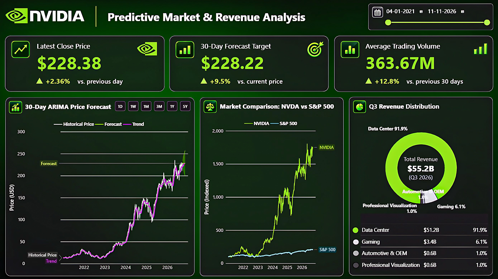
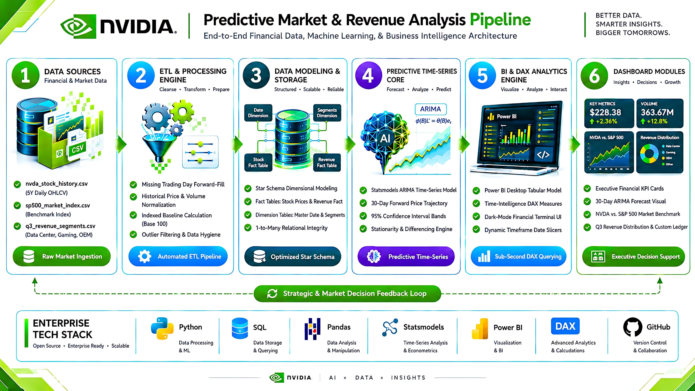

# 📈 NVIDIA – Predictive Market & Revenue Analysis


<p align="center">
  
</p>

> **Architecting an end-to-end Data Analytics pipeline that transforms raw market data into actionable business intelligence. This project evaluates NVIDIA's financial health, benchmarks its market outperformance, forecasts short-term price momentum using ARIMA, and delivers a sleek, dark-mode executive business intelligence terminal.**

---

## 📌 Table of Contents
- [Overview](#overview)
- [Business Problem](#business-problem)
- [Dataset](#dataset)
- [Tools & Technologies](#tools--technologies)
- [Project Structure](#project-structure)
- [Data Processing & Modeling](#data-processing--modeling)
- [Predictive Analytics Core](#predictive-analytics-core)
- [Key Findings & Financial Health](#key-findings--financial-health)
- [Dashboard](#dashboard)
- [Architecture](#architecture)
- [How to Run This Project](#how-to-run-this-project)
- [Results & Conclusion](#results--conclusion)
- [Strategic Recommendations](#strategic-recommendations)
- [Future Work](#future-work)
- [Author & Contact](#author--contact)

---

<h2 id="overview">📖 Overview</h2>

This project is a comprehensive Financial Data Analytics and Time-Series Forecasting solution. The foundation is a production-grade data pipeline built using Python (Pandas) and SQL for data extraction, transformation, and data hygiene. Advanced predictive capabilities are driven by the statsmodels library to execute precise ARIMA modeling and forward-looking price forecasting. The entire workflow culminates in Power BI, delivering an interactive, pixel-perfect, dark-mode financial terminal specifically engineered for high-level executive decision support.

---

<h2 id="business-problem">🎯 Business Problem</h2>

Evaluating high-growth tech market leaders requires looking beyond surface-level price trends to understand underlying revenue drivers and sustainability. Financial analysts face several challenges when evaluating extreme market momentum. This project aims to:
- **Clarify Revenue Concentration Risk:** Provide immediate, visual clarity on how heavily the company relies on single sectors (like AI data centers) versus legacy sectors (like gaming).
- **Establish Market Context:** Isolate true performance from general market inflation by directly mathematically benchmarking the asset against the broader S&P 500 index.
- **Forecast Short-Term Volatility:** Deploy reliable, statistically sound time-series price forecasting to proactively identify short-term entry, exit, or holding targets before market shifts occur.

---

<h2 id="dataset">🗂️ Dataset</h2>

- **Raw Data:** Sourced via flat CSV files stored in the `/data/` directory containing 5-year daily OHLCV (Open, High, Low, Close, Volume) stock history (`nvda_stock_history.csv`), S&P 500 benchmark data (`sp500_market_index.csv`), and quarterly revenue segment breakdowns (`q3_revenue_segments.csv`).
- **Relational Data Model:** Unified Star Schema architecture connecting Fact Tables (Stock Prices & Revenue) with Dimension Tables (Master Date & Segments) for seamless BI integration.

---

<h2 id="tools--technologies">🛠️ Tools & Technologies</h2>

| Category | Tools & Technologies Used |
| :--- | :--- |
| **Data Processing & Preprocessing** | Python, Pandas, NumPy |
| **Data Extraction & Storage** | SQL |
| **Machine Learning & Forecasting** | Statsmodels (ARIMA Time-Series Modeling) |
| **Data Visualization & BI** | Power BI, DAX (Time-Intelligence) |
| **Web Application & UI** | Custom Dark-Mode Financial UI, Layered Tabular Legends |
| **Version Control & Design** | Git, GitHub, VS Code |

---

<h2 id="project-structure">📂 Project Structure</h2>

```text
NVIDIA-Financial-Predictive-Analytics/
│
├── README.md                    # Main project documentation and findings
├── requirements.txt             # Production dependency manifest
│
├── dashboard/                   # Core business intelligence files
│   └── dashboard.pbix
│
├── data/                        # Project datasets
│   ├── processed/               # Python-generated CSVs connected to Power BI
│   │   ├── cleaned_stock_data.csv
│   │   ├── nvidia_arima_forecast.csv
│   │   ├── q3_revenue_segments.csv
│   │   └── sp500_index_data.csv
│   └── raw/                     # Original market and revenue CSV files
│       ├── nvda_stock_history.csv
│       └── sp500_market_index.csv
│
├── docs/                        # Project PRD and executive completion reports
│   └── NVIDIA_Project_Report.pdf
│
├── notebooks/                   # Jupyter notebooks covering exploratory workstreams
│   └── 02_trend_analysis_eda.ipynb
│
├── scripts/                     # Enterprise Python processing scripts
│   ├── 01_data_extraction_cleaning.py
│   └── 03_arima_forecasting.py
│
└── images/                      # Visual assets and dashboard screenshots
    ├── architecture_diagram.png
    ├── ARIMA_price_forecast.png
    ├── dashboard.png
    ├── market_comparison.png
    └── revenue_distribution.png

```

---

<h2 id="data-processing--modeling">🔒 Data Processing & Modeling</h2>

* **Data Hygiene & Validation:** Handled missing weekend and holiday trading volumes via forward-filling to maintain continuous time-series mathematical integrity without skewing the predictive model.
* **Feature Engineering:** Calculated Baseline 100 indexing to mathematically normalize and compare individual stock growth directly against the broader S&P 500 index, regardless of underlying raw price differences.
* **Optimized Rendering Architecture:** Deployed a 1-to-Many Star Schema data model to prevent many-to-many relationship ambiguity, ensuring sub-second DAX querying and immediate filter responsiveness.
* **Advanced UI Formatting:** Bypassed native Power BI limitations by injecting transparent text boxes and shapes to build a pixel-perfect, custom tabular legend for revenue distribution.

---

<h2 id="predictive-analytics-core">⚡ Predictive Analytics Core</h2>

**Time-Series Execution:**

* Engineered a robust **ARIMA (AutoRegressive Integrated Moving Average)** model utilizing Python's `statsmodels` library to evaluate historical trends.
* Processed historical closing prices to project a mathematically sound 30-day forward-looking price trajectory.
* Calculated and rendered upper and lower **95% confidence interval bands** to visually establish market volatility and risk parameters directly for the end-user.

---

<h2 id="key-findings--financial-health">📈 Key Findings & Financial Health</h2>

1. **Extreme Revenue Concentration:** Total Q3 revenue reached $55.2B, but **92.7% ($51.2B)** is driven entirely by the Data Center segment. Gaming accounts for just 6.2%, highlighting a massive dependency shift.
2. **Massive Market Outperformance:** When indexed to a Base 100 scale, the asset demonstrated **+342.7%** growth, vastly outpacing the S&P 500's +78.4% benchmark over the exact same period.
3. **High Liquidity & Momentum:** Average trading volume remains exceptionally high at **363.67M**, indicating sustained institutional backing.
4. **Primary Predictive Drivers:** The ARIMA time-series model projects a continued bullish trend, processing the latest $228.38 close price to forecast an expected **+9.5% yield** over the next 30 days.

---

<h2 id="dashboard">📊 Dashboard</h2>

**Power BI Dashboard Features:**

* Executive KPI Grid displaying Latest Close Price, 30-Day Target, and Average Trading Volume.
* Interactive Button Slicers for dynamic timeframe filtering (1D, 1W, 1M, 3M, 1Y, 5Y).
* 30-Day ARIMA Price Forecast chart overlaying predictive trendlines and confidence cones.
* Indexed Market Comparison line chart benchmarking performance against the S&P 500.
* Q3 Revenue Distribution donut chart paired with a custom-engineered segment ledger.

<br>

**Executive View:**



---

<h2 id="architecture">🏗️ Architecture</h2>

The system follows an end-to-end data engineering and predictive analytics pipeline architecture, progressing from multi-source data ingestion to interactive dashboard deployment.

<br>



---

**Pipeline Component Breakdown:**

- **1. Data Sources:** Ingests raw structured market datasets comprising `nvda_stock_history.csv` and `sp500_market_index.csv` utilizing the `yfinance` API, alongside Q3 SEC revenue segment data.
- **2. Processing Engine:** Executes automated data hygiene via Python and Pandas, applying forward-filling for weekend/holiday trading gaps, standardizing columns, and engineering Baseline 100 indexing metrics for market comparison.
- **3. Relational Storage:** Houses processed relational datasets within a local SQL database engine and exports finalized flat files to the `/data/processed/` directory, architected into a Star Schema (Fact and Dimension tables) for rapid downstream querying.
- **4. Predictive Time-Series Core:** Evaluates historical market trends and fits an ARIMA time-series model using `statsmodels` to generate a mathematically sound 30-day forward price prediction alongside 95% upper and lower confidence intervals.
- **5. BI & DAX Analytics Engine:** Processes the structured data model utilizing dynamic time-intelligence DAX measures and interactive relationship filtering within Microsoft Power BI.
- **6. Dashboard Modules:** Deploys a full-stack, custom-engineered dark-mode financial terminal (`dashboard.pbix`) featuring executive KPI cards, an indexed market benchmark, and a custom tabular revenue ledger.

---

<h2 id="how-to-run-this-project">⚙️ How to Run This Project</h2>

**1. Clone the repository:**

```bash
git clone https://github.com/Swayanshu-Jena/NVIDIA-Financial-Predictive-Analytics.git
cd NVIDIA-Financial-Predictive-Analytics

```

**2. Install dependencies:**

```bash
pip install -r requirements.txt

```

**3. Run the Backend Scripts:**

* Execute `python scripts/01_data_extraction_cleaning.py` to run the ETL pipeline.
* Execute `python scripts/03_arima_forecasting.py` to generate the predictive mathematical models.
* Review `notebooks/02_trend_analysis_eda.ipynb` for exploratory data analysis and visual validation.

**4. Launch the Dashboard:**

* Open `dashboard/dashboard.pbix` in Microsoft Power BI Desktop to interact with the finalized financial terminal.

---

<h2 id="results--conclusion">✅ Results & Conclusion</h2>

This project successfully established an end-to-end financial analytics and machine learning solution that bridges raw market records and actionable executive decision-making. By combining Python's predictive modeling power with Power BI's interactive deployment, investors are equipped to monitor market momentum comprehensively. The analysis demonstrates that while the company exhibits extreme market outperformance, its hyper-reliance on Data Center infrastructure presents a localized risk that requires continuous supply chain monitoring.

---

<h2 id="strategic-recommendations">💡 Strategic Recommendations</h2>

* **Double-Down on Primary Investments:** Aggressively reinvest capital into Data Center R&D and supply chain logistics, as it dictates 92.7% of total revenue.
* **Review Legacy Divisions:** Route strategic review resources toward the Automotive & OEM and Professional Visualization segments (1.0% each) to ensure their operational costs are justified by future market capture.
* **Monitor Short-Term Volatility:** Utilize the 30-day ARIMA +9.5% yield forecast to optimize short-term entry points, setting stop-losses at the lower bounds of the 95% confidence interval.

---

<h2 id="future-work">🚀 Future Work (Technical)</h2>

* **Live API Integration:** Connect the Power BI dashboard directly to the Yahoo Finance or Alpha Vantage REST APIs to stream daily stock prices automatically.
* **Sentiment Analysis:** Scrape recent financial news articles and apply a Natural Language Processing (NLP) model to add a real-time "Market Sentiment Score" KPI to the dashboard.
* **CI/CD Pipeline:** Automate notebook execution testing and script validation using GitHub Actions.

---

<h2 id="author--contact">👨‍💻 Author & Contact</h2>

**Swayanshu Jena-** *Data Analyst | B.Tech CSE Graduate* 

📧 **Email:** swayanshu.j00@gmail.com

🔗 **LinkedIn:** [linkedin.com/in/swayanshu-jena](https://www.linkedin.com/in/swayanshu-jena)

💻 **GitHub:** [github.com/Swayanshu-Jena](https://github.com/Swayanshu-Jena)

*❤️ Thank you for viewing my project! I am actively looking for Data Scientist and Data Analyst opportunities and I welcome any connections, feedback, or collaboration."
